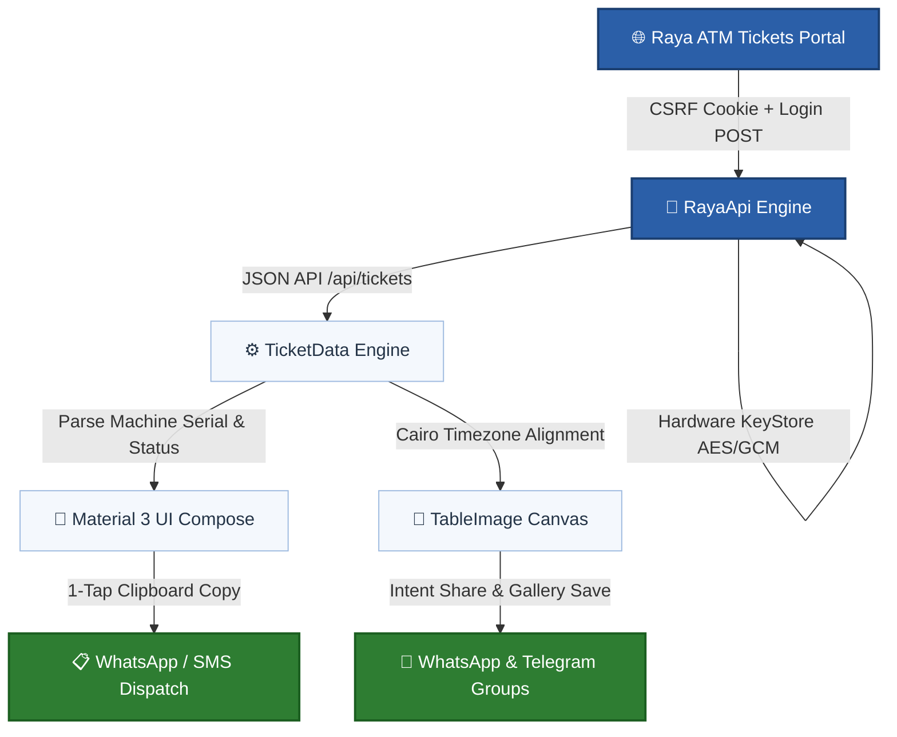

# 🏧 Raya Ticket Manager (RTM)

[](https://android.com)
[](https://kotlinlang.org)
[](https://developer.android.com/jetpack/compose)
[](https://github.com/Abdelpaset/RayaTicketManager/actions)
[](https://developer.android.com/training/articles/keystore)

**An ultra-compact, high-performance native Android application engineered for Raya ATM field service engineers.**  
Automates ticket synchronization, hardware machine serial tracking, field dispatching, and high-resolution table image rendering for instant WhatsApp and Telegram team reporting.

---

## 📌 Architecture & Data Flow



---

## ✨ Key Features

### ⚡ Smart Field Synchronization
* **Direct JSON Traversal**: Connects directly to `/api/tickets`, reading multi-page datasets (`meta.last_page`) in high-speed batches.
* **Simultaneous Status Filtering**:
  * **`Pending`**: Isolates open, in-progress, or dispatched calls (`status_id: 1`, `is_closed: 0`).
  * **`Resolved`**: Filters tickets closed today to measure daily engineer productivity and completed repairs (`status_id: 4`, `is_closed: 1`).
  * **Both Simultaneously**: Toggle both chips on to fetch and display the entire operational workload without restrictions.
* **Standard Call Types**: Always includes and filters by all major field categories: `call`, `Call Back`, `Customer Request`, `PM`, and `Installation`.

### 🖥️ Ultra-Compact Material 3 Interface
* **Zero Wasted Space**: Header title and redundant session lines removed to pull the workspace directly to the top of the viewport.
* **Safe Status Bar Clearance**: Configured with `Modifier.statusBarsPadding()` to guarantee the user's name and logout action never collide with the camera cutout or system battery/clock icons.
* **2×2 Control Hub**: Combines `From` / `To` date pickers, `Pending` / `Resolved` chips, and the primary `Sync` action into two tightly budgeted rows.
* **Centered Universal Search**: Full-width search bar with centered placeholder querying **Site Name**, **Ticket Serial**, **Machine Serial**, and **Engineer** in real time.
* **Balanced Filter Row**: `Assignee`, `Status`, and `Call Type` chips evenly distributed across the entire screen width.

### 🏧 Real Machine Hardware Serial Tracking
* **Hardware Serial Number (`Machine`)**: Extracts and displays the physical 10-digit Diebold Nixdorf machine chassis serial number (starting with `531...`) from column **`Machine`**, cleanly distinguished from the bank's internal ATM ID.
* **Structured Ticket Cards**:
  * Displays Ticket Serial, Site Name, Machine Serial (`531...`), Two-part Engineer Name, and Status with full color indicators.
* **One-Tap Clipboard Copy**: Tapping the copy icon (📋) formats and copies the entire dispatch payload ready for immediate paste into team chat:
  ```text
  Ticket: 26110100848
  Site: NBE - Doctor Tahani Pharmacy
  Machine: 5310561926
  Engineer: Abdel Baset
  Status: Resolved (Repaired)
  Start: 03/11/2026 13:00
  ```
* **Full Text Selection**: Ticket cards are enclosed within `SelectionContainer` for arbitrary text highlighting.

### 🎨 Native Canvas Table Image Generator (`TableImage`)
* **Vector-Clear Bitmap Graphics**: Renders summary tables directly to high-density bitmaps with custom text wrapping, contrasting headers (`#2B5FA8`), and Cairo-aligned overdue row highlighting.
* **Anti-Bleed Column Clipping**: Applies strict `canvas.clipRect()` boundaries per column to guarantee long text strings never overlap adjacent cells.
* **Quick-Access Action Header**: `Share` and `Save` buttons are positioned at the very top of the preview card beside the live ticket counter (`Tickets Count: X`), allowing immediate export without scrolling.

---

## 🔄 In-Place Update System (No Signature Collisions)

> [!TIP]
> **No more uninstalling old versions!** Every build is signed using a permanent repository keystore and increments `versionCode` automatically on GitHub Actions, allowing instant over-the-air updates directly on your device.

* **Static Debug Keystore**: Builds are deterministically signed with a permanent 2048-bit RSA certificate (`app/debug.keystore`) valid for 10,000 days (through 2054).
* **Automated CI Version Incrementing**: GitHub Actions passes `-PversionCode=${{ github.run_number }}` on every run.

---

## 📂 Project Structure

| File / Folder | Role & Description |
| :--- | :--- |
| **`.github/workflows/build-apk.yml`** | GitHub Actions CI workflow building APKs with dynamic versioning |
| **`app/debug.keystore`** | Static debug signing certificate (RSA 2048-bit, valid to 2054) |
| **`app/build.gradle.kts`** | App dependencies, Material 3 BOM, and signing configurations |
| **`MainActivity.kt`** | Jetpack Compose UI, 2×2 grid, centered search & card lists |
| **`RayaApi.kt`** | OkHttp engine, Sanctum CSRF/CookieJar & status-aware sync |
| **`TableImage.kt`** | Native Canvas bitmap renderer with column-clipping protection |
| **`TicketData.kt`** | Machine serial parser, JSON/CSV/XLSX readers & Cairo date logic |

---

## ⚙️ Technical Specifications

| Component | Technical Details |
| :--- | :--- |
| **Minimum SDK** | Android 8.0 (API Level 26) |
| **Target / Compile SDK** | Android 15 (API Level 35) |
| **Language & Tooling** | Kotlin 2.x • Java 17 • Gradle 8.12.1 |
| **UI Architecture** | Jetpack Compose (BOM 2025.04.01) • Material 3 • SelectionContainer |
| **Network Client** | OkHttp 4.12.0 with custom CookieJar, Interceptor & URLDecoder |
| **Local Key Storage** | AndroidKeyStore (AES/GCM/NoPadding) via Encrypted SharedPreferences |
| **Spreadsheet Engines** | Apache Commons CSV 1.12.0 & Streaming XmlPullParser (XLSX) |
| **Operating Timezone** | Egypt Standard Time (`Africa/Cairo`) |

---

## 🚀 Getting Started

### Download the Latest APK
1. Open the **[GitHub Actions Tab](https://github.com/Abdelpaset/RayaTicketManager/actions)**.
2. Click on the latest workflow run marked with a green checkmark (**✔**).
3. Scroll down to the **Artifacts** section and download **`RayaTicketManager-debug`**.
4. Unzip and install `app-debug.apk` directly on your Android device.

---

<div align="center">

**Developed with precision for ATM Field Service Engineering.**  
*Raya Information Technology • Financial Services Division*

</div>